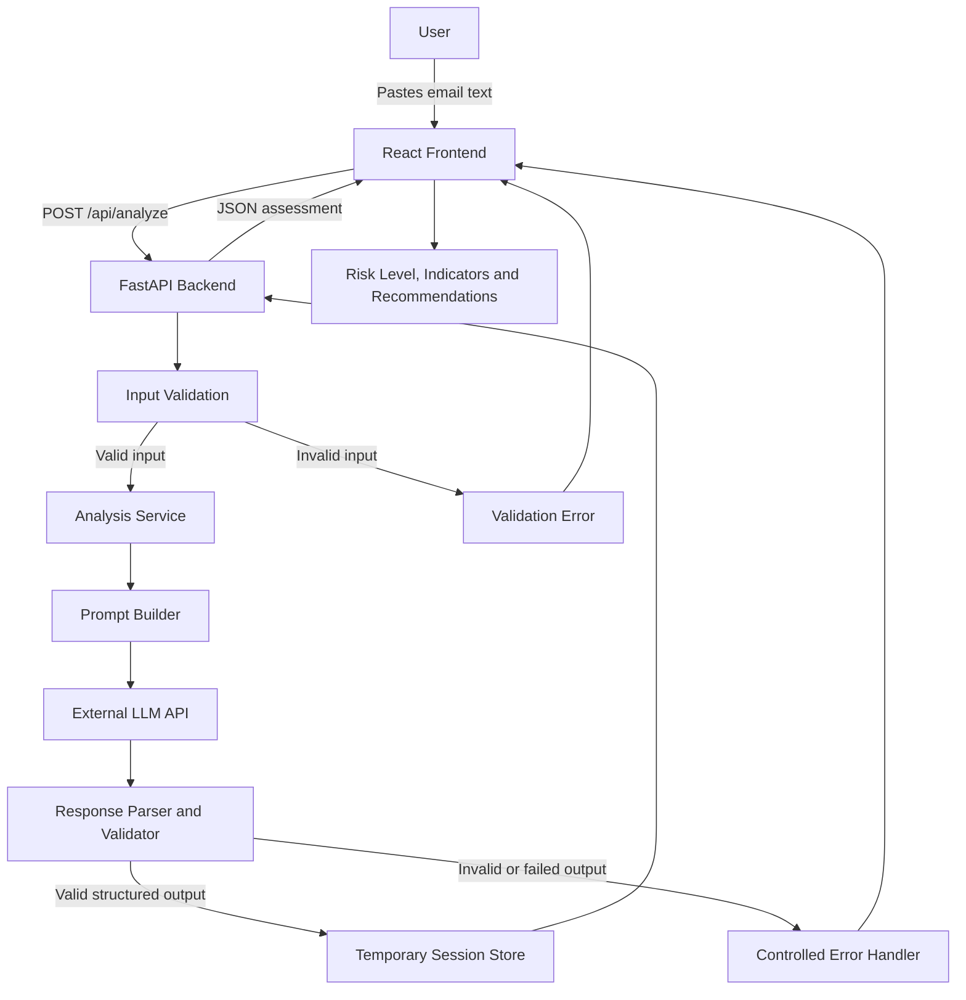

# High-Level Architecture Plan — PhishGuard AI

## 1. Purpose

This document describes the proposed high-level architecture for PhishGuard AI, a web application that analyzes user-submitted email text for common phishing indicators and returns an explainable, AI-assisted assessment.

The architecture is intentionally lightweight so the team can build, test, and deploy an MVP during a 24-hour hackathon.

## 2. Architecture Goals

- Provide a simple and understandable user workflow.
- Separate the frontend, backend, and AI integration.
- Keep AI provider credentials out of the browser.
- Validate inputs and AI responses.
- Return structured results that the frontend can display consistently.
- Minimize collection and retention of user-submitted email content.
- Support a live demo and straightforward local development.

## 3. Proposed Technology Stack

The following is the proposed stack. The team may adjust it to match its existing skills and available services, but should agree on one implementation before development begins.

| Layer | Proposed technology | Responsibility |
|---|---|---|
| Frontend | React with HTML/CSS/JavaScript | Input form, loading state, results, and session history. |
| Backend API | Python with FastAPI | Input validation, orchestration, error handling, and response formatting. |
| AI service | LLM API selected by the team | Identify common phishing indicators and generate an explanation. |
| Temporary data | In-memory session store | Keep request and result history during the active application session. |
| Version control | Git and GitHub | Branching, code review, and team collaboration. |
| Deployment | Vercel for frontend and Render for backend, or one suitable alternative | Host the demo and make it accessible to reviewers. |
| Testing | pytest and manual browser testing | Validate API behavior and the main user workflow. |

**Important:** The selected AI provider and deployment platform must be confirmed by the team based on access, pricing, rate limits, and the hackathon environment. API keys must be stored as server-side environment variables.

## 4. High-Level Component Architecture



## 5. Main Components

### 5.1 Frontend

The frontend is responsible for:
- Displaying the product name and a short explanation.
- Providing a text area for email content.
- Validating that the input is not empty before submission.
- Sending the request to the backend API.
- Showing a loading state while analysis is running.
- Displaying the risk level, summary, warning signs, and recommendations.
- Showing clear error messages.
- Displaying analysis history for the current session, if implemented.

The frontend must not contain the AI provider's secret API key or call the provider directly.

### 5.2 Backend API

The backend exposes the main analysis endpoint:

`POST /api/analyze`

**Example request:**
```json
{
  "email_text": "Your account will be closed today. Verify your details immediately."
}
```

**Example successful response:**
```json
{
  "request_id": "req-001",
  "risk_level": "medium",
  "summary": "The message uses urgent language and requests immediate action.",
  "indicators": [
    {
      "category": "urgency",
      "severity": "medium",
      "description": "The message pressures the recipient to act immediately."
    }
  ],
  "recommendations": [
    "Do not click links in the message.",
    "Verify the request through the organization's official website."
  ],
  "disclaimer": "AI analysis may be incomplete or incorrect. This result is not a guarantee of safety."
}
```

The backend is responsible for:
- Checking request format and input length.
- Creating a request identifier.
- Building the AI prompt.
- Calling the AI provider securely.
- Parsing and validating the AI response.
- Returning a predictable JSON structure.
- Handling timeouts, rate limits, invalid responses, and provider errors.
- Keeping temporary session history if that feature is implemented.

### 5.3 AI Analysis Service

The AI service receives the submitted email text through the backend. The prompt should ask the model to:
- Identify common phishing indicators.
- Distinguish observed evidence from assumptions.
- Assign one of the allowed risk levels: `low`, `medium`, or `high`.
- Explain the assessment in plain language.
- Provide safe recommendations.
- Return structured output in the agreed JSON format.
- Avoid claiming that an email is definitely safe based only on its text.

The backend must validate the returned structure and allowed values. AI output is not trusted automatically.

### 5.4 Temporary Session Store

The MVP does not require a permanent database. The backend may keep completed analyses in memory for the current session so users can review recent results.

If the team implements history only in frontend session state, the frontend should clearly treat it as temporary. In either implementation, the MVP should avoid permanent storage of submitted email content.

## 6. Data Flow

1. The user opens the web application.
2. The frontend displays the email input form and a privacy notice.
3. The user pastes email text and submits it.
4. The frontend checks that the input is not empty and sends it to `POST /api/analyze`.
5. The backend validates the request and applies the configured input-size limit.
6. The backend builds a prompt and sends the text to the selected LLM provider.
7. The AI provider returns a proposed structured assessment.
8. The backend parses and validates the response, including the risk level and indicator fields.
9. The backend returns a normalized JSON response to the frontend.
10. The frontend displays the result and, where implemented, adds it to the current session history.

If a validation or provider error occurs, the backend returns a clear error response and the frontend allows the user to retry when appropriate.

## 7. API Contract

### `POST /api/analyze`

**Purpose:** Analyze submitted email text.

**Request body:**
```json
{
  "email_text": "string"
}
```

**Success response:** HTTP `200 OK`, with:
- `request_id`
- `risk_level`
- `summary`
- `indicators`
- `recommendations`
- `disclaimer`

**Possible error responses:**

| HTTP status | Meaning |
|---|---|
| 400 | Missing or invalid input. |
| 413 | Input exceeds the configured size limit. |
| 429 | AI provider or application rate limit reached. |
| 502 | AI provider returned an invalid or unusable response. |
| 503 | AI provider is temporarily unavailable. |
| 500 | Unexpected server error. |

Error responses should use a consistent format, for example:

```json
{
  "error": {
    "code": "INVALID_INPUT",
    "message": "Please enter email text before submitting."
  }
}
```

The exact response schema should be agreed upon by frontend and backend developers before implementation.

## 8. Security, Privacy, and Reliability

- **Secret management:** Store provider API keys in backend environment variables. Never commit secrets to GitHub.
- **Input validation:** Reject empty input and enforce a maximum request size.
- **Data minimization:** Do not request credentials or unnecessary personal information.
- **Logging:** Do not log full submitted email bodies or API secrets.
- **External processing:** Inform users that submitted text may be processed by the selected AI provider.
- **Output validation:** Treat model output as untrusted; validate fields and allowed values before displaying it.
- **Error handling:** Handle provider timeouts, rate limits, and malformed responses.
- **Safe guidance:** Do not automatically open, fetch, or visit URLs found in submitted email text.
- **Limitations:** Display a disclaimer that an AI-generated assessment is not a definitive security verdict.

## 9. Testing Plan

| Test area | Example test |
|---|---|
| Input validation | Submit an empty string and whitespace-only text. |
| Input limits | Submit text longer than the configured maximum. |
| Successful analysis | Submit a sample email and verify the response schema. |
| Risk-level validation | Verify only `low`, `medium`, or `high` is accepted. |
| AI failure | Simulate a provider timeout or unavailable service. |
| Invalid AI output | Return malformed JSON or missing required fields from a mocked AI service. |
| Frontend states | Verify loading, success, and error states. |
| Privacy | Confirm that secrets are not present in frontend assets or Git history. |
| Responsive UI | Test the main workflow on desktop and a narrow mobile viewport. |

## 10. Deployment Plan

1. Create the GitHub repository structure and agree on the main branch workflow.
2. Configure frontend and backend environment variables locally.
3. Run the backend and frontend locally.
4. Test the end-to-end analysis workflow using sample email text.
5. Deploy the backend and configure its AI provider secret in the hosting platform.
6. Deploy the frontend and configure the backend API URL.
7. Test the public demo URL from a separate browser session.
8. Add setup instructions, environment variable names (not values), and the demo link to the project README.

## 11. Suggested Repository Structure

```text
ai_enhanced_team_hackathon/
├── team_ideation.md
├── user_stories.md
├── data_model.md
├── architecture_plan.md
├── README.md
├── frontend/
│   ├── src/
│   └── package.json
├── backend/
│   ├── app/
│   ├── tests/
│   └── requirements.txt
└── .gitignore
```

The actual source-code folders can be created during implementation. The `.gitignore` file must exclude local environment files such as `.env`.

## 12. Implementation Priorities for the 24-Hour Hackathon

| Priority | Work item | Expected result |
|---|---|---|
| 1 | Agree on API contract and response schema | Frontend and backend can work in parallel. |
| 2 | Build the input form and results layout | User can submit text and view a result. |
| 3 | Implement backend validation and AI integration | API returns a structured assessment. |
| 4 | Integrate frontend and backend | End-to-end workflow works. |
| 5 | Add error handling and essential tests | Main failure cases are handled. |
| 6 | Deploy and verify the demo | Reviewers can access the working MVP. |

## 13. Architecture Decision

The team proposes a simple three-layer architecture: React frontend, FastAPI backend, and an external LLM API. Temporary session state is sufficient for the hackathon MVP, so a permanent database is intentionally excluded from the initial scope. This reduces implementation time and limits unnecessary retention of potentially sensitive email content while leaving room for future expansion.
