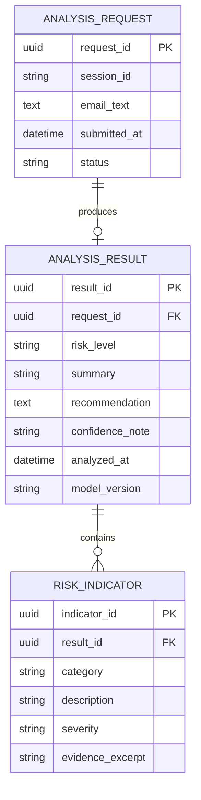

# Data Model — PhishGuard AI

## 1. Overview

PhishGuard AI accepts email text, requests an AI-assisted analysis, and presents a structured result. The MVP uses three core entities:

1. **AnalysisRequest** — represents one submission made by a user.
2. **AnalysisResult** — stores the assessment generated for that submission.
3. **RiskIndicator** — represents an individual warning sign or observation included in the assessment.

The model is designed to support the MVP without requiring user accounts or permanent storage of email content. In the initial implementation, records may exist in application memory for the current session. If persistent storage is introduced later, the team must review privacy, retention, and access controls first.

## 2. Entities and Attributes

### Entity 1: AnalysisRequest

Represents the text submitted for analysis.

| Attribute | Type | Constraints / Description |
|---|---|---|
| request_id | UUID | Primary identifier; generated by the application. |
| session_id | String / UUID | Identifies the current browser session; not an account identity. |
| email_text | Text | Required submitted email content; enforce a maximum length. |
| submitted_at | DateTime | Timestamp in UTC when the request was received. |
| status | Enum | `pending`, `completed`, or `failed`. |

**Notes:**
- `email_text` is sensitive user-provided content and should not be logged unnecessarily.
- The MVP should keep request data in temporary session storage or memory rather than a permanent database.
- Do not collect passwords, authentication codes, or other credentials.

### Entity 2: AnalysisResult

Represents the structured assessment generated for an AnalysisRequest.

| Attribute | Type | Constraints / Description |
|---|---|---|
| result_id | UUID | Primary identifier. |
| request_id | UUID | Foreign key referencing `AnalysisRequest.request_id`; one result belongs to one request. |
| risk_level | Enum | `low`, `medium`, or `high`. |
| summary | String | Short explanation of the overall assessment. |
| recommendation | Text | Safe next steps for the user. |
| confidence_note | String | Optional explanation that the assessment may be incomplete or incorrect. |
| analyzed_at | DateTime | Timestamp in UTC when analysis completed. |
| model_version | String | Optional identifier for the AI model or prompt version used. |

**Notes:**
- The risk level is an AI-assisted estimate, not a verified security verdict.
- If analysis fails, the request status should be `failed`; do not create a misleading successful result.

### Entity 3: RiskIndicator

Represents one warning sign or observation identified during analysis.

| Attribute | Type | Constraints / Description |
|---|---|---|
| indicator_id | UUID | Primary identifier. |
| result_id | UUID | Foreign key referencing `AnalysisResult.result_id`. |
| category | Enum / String | For example: `urgency`, `suspicious_link`, `sender_mismatch`, `credential_request`, or `other`. |
| description | String | Human-readable explanation of the indicator. |
| severity | Enum | `low`, `medium`, or `high`. |
| evidence_excerpt | String, optional | Short relevant excerpt from the submitted text; omit if not needed. |

**Notes:**
- An analysis result may have zero or more risk indicators.
- Evidence excerpts should be kept short and should not expose unnecessary personal information.

## 3. Relationships

- One **AnalysisRequest** can have zero or one **AnalysisResult**.
- One **AnalysisResult** belongs to exactly one **AnalysisRequest**.
- One **AnalysisResult** can have zero or many **RiskIndicators**.
- Each **RiskIndicator** belongs to exactly one **AnalysisResult**.

## 4. Entity Relationship Diagram



## 5. Example Data

The following is illustrative sample data, not a real email or a real security verdict.

**AnalysisRequest**
```json
{
  "request_id": "req-001",
  "session_id": "session-demo-01",
  "email_text": "Your account will be closed today. Verify your details immediately.",
  "submitted_at": "2026-11-17T10:00:00Z",
  "status": "completed"
}
```

**AnalysisResult**
```json
{
  "result_id": "res-001",
  "request_id": "req-001",
  "risk_level": "medium",
  "summary": "The message uses urgent language and requests immediate action.",
  "recommendation": "Do not follow links in the message. Contact the organization through its official website or a known phone number.",
  "confidence_note": "This is an AI-generated assessment and may be incomplete.",
  "analyzed_at": "2026-11-17T10:00:03Z",
  "model_version": "hackathon-prompt-v1"
}
```

**RiskIndicator**
```json
{
  "indicator_id": "ind-001",
  "result_id": "res-001",
  "category": "urgency",
  "description": "The message creates pressure by threatening account closure today.",
  "severity": "medium",
  "evidence_excerpt": "Your account will be closed today"
}
```

## 6. Validation and Data Integrity

- Every identifier must be unique.
- `AnalysisRequest.email_text` must not be empty and must respect the configured maximum length.
- `AnalysisRequest.status` must use an allowed value.
- `AnalysisResult.risk_level` must be `low`, `medium`, or `high`.
- Every `AnalysisResult.request_id` must reference an existing request.
- Every `RiskIndicator.result_id` must reference an existing result.
- The backend must validate AI output before returning it to the frontend. Invalid or incomplete AI output should produce a controlled error, not an invented risk assessment.

## 7. Privacy and Retention

For the hackathon MVP:
- Do not require registration or collect unnecessary personal information.
- Do not store submitted email text permanently by default.
- Avoid logging full email content or sensitive excerpts.
- Keep AI provider credentials in server-side environment variables.
- Tell users if their text is sent to an external AI provider for processing.
- Clear temporary session data when the session ends or when the application is reset.

A future production version would need a documented retention policy, access controls, encryption, and a privacy review before introducing persistent storage.
