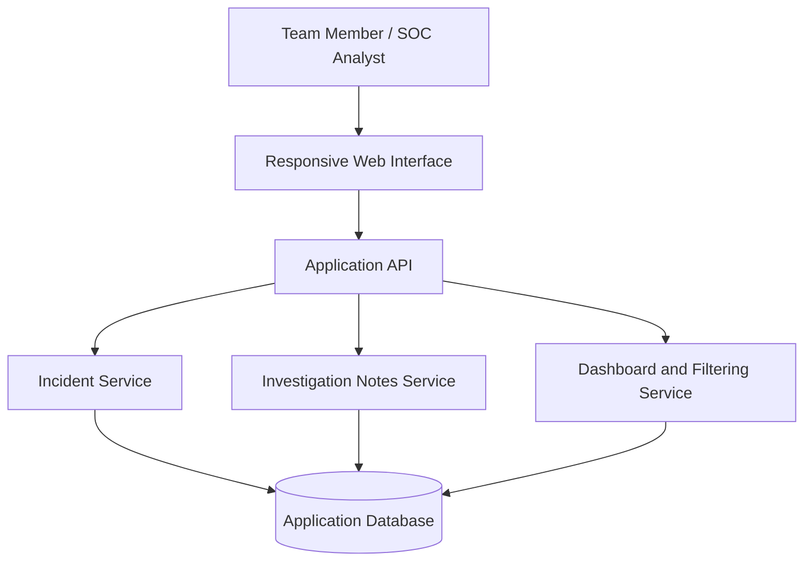

# High-Level Architecture - SOC Incident Tracker

## 1. Overview

SOC Incident Tracker is a lightweight web application for small IT and security teams. Users manually create and manage incidents, review dashboard summaries, filter the incident list, and add investigation notes.

The initial architecture keeps the application simple and separates the user interface, application/API logic, and persistent data storage.

## 2. System Diagram

## 3. Main Components

### Responsive Web Interface
- Provides the incident dashboard.
- Contains the incident submission form.
- Displays incident details and investigation notes.
- Provides filters for priority and status.
- Displays summary counts by priority and status.
- Supports desktop and mobile screen sizes.

### Application API
- Receives requests from the web interface.
- Validates submitted data.
- Routes requests to the appropriate application service.
- Returns success responses or clear error messages.

### Incident Service
- Creates and retrieves incidents.
- Updates incident priority and status.
- Supports filtering by priority and status.

### Investigation Notes Service
- Creates notes associated with an incident.
- Retrieves notes for an incident.
- Records the creation date and time of each note.

### Dashboard and Filtering Service
- Calculates incident counts grouped by priority.
- Calculates incident counts grouped by status.
- Returns filtered incident lists.

### Application Database
- Stores incident records.
- Stores investigation notes linked to incidents.
- Maintains the relationship between incidents and notes.

## 4. Main Data Flow

1. A team member opens the web application.
2. The user submits an incident through the incident form.
3. The interface sends the incident data to the Application API.
4. The API validates the input and passes it to the Incident Service.
5. The Incident Service saves the incident in the database.
6. The dashboard retrieves incident records and summary counts.
7. A team member can update the incident status or priority.
8. A team member can add investigation notes; the Notes Service stores them and links them to the relevant incident.

## 5. MVP Constraints and Out-of-Scope Components

- No authentication or role-based access control in the first version.
- No automatic integration with Wazuh, Splunk, or other SIEM tools.
- No automatic alert ingestion; incidents are entered manually.
- No email, SMS, or push notification service.
- No advanced analytics or threat-intelligence enrichment.

## 6. Architecture Rationale

This architecture is intentionally small for an MVP. Separating the interface, API, application services, and database makes the main responsibilities clear without introducing unnecessary infrastructure. The design can later be extended with authentication, SIEM integrations, and notification services if the product requirements grow.
