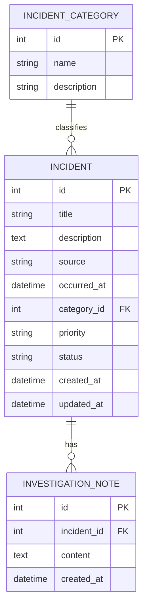

# Data Model - SOC Incident Tracker

## 1. Overview

The MVP uses three core entities:

1. **Incident** - a security event recorded by a team member.
2. **InvestigationNote** - a note describing findings or actions taken during an investigation.
3. **IncidentCategory** - a classification used to group incidents.

Priority and status are represented as controlled values on the Incident entity.

## 2. Entities and Attributes

### Entity: Incident

| Attribute | Type | Required | Description |
|---|---|---:|---|
| id | UUID / Integer | Yes | Unique incident identifier. |
| title | String | Yes | Short incident title. |
| description | Text | Yes | Details of the reported security event. |
| source | String | Yes | Where the event was reported or observed. |
| occurred_at | DateTime | Yes | Date and time associated with the incident. |
| category_id | UUID / Integer | Yes | Reference to the incident category. |
| priority | Enum | Yes | Low, Medium, High, or Critical. |
| status | Enum | Yes | New, In Progress, Resolved, or Closed. |
| created_at | DateTime | Yes | Date and time the record was created. |
| updated_at | DateTime | Yes | Date and time the record was last updated. |

### Entity: InvestigationNote

| Attribute | Type | Required | Description |
|---|---|---:|---|
| id | UUID / Integer | Yes | Unique note identifier. |
| incident_id | UUID / Integer | Yes | Reference to the incident this note belongs to. |
| content | Text | Yes | Investigation finding or action note. |
| created_at | DateTime | Yes | Date and time the note was created. |

### Entity: IncidentCategory

| Attribute | Type | Required | Description |
|---|---|---:|---|
| id | UUID / Integer | Yes | Unique category identifier. |
| name | String | Yes | Category name. |
| description | String | No | Short explanation of the category. |

Initial category values:
- Phishing
- Malware
- Suspicious Login
- Network Activity

## 3. Controlled Values

### Incident Priority
- `Low`
- `Medium`
- `High`
- `Critical`

### Incident Status
- `New`
- `In Progress`
- `Resolved`
- `Closed`

## 4. Relationships

- One IncidentCategory can classify many incidents.
- Each Incident belongs to one IncidentCategory.
- One Incident can have zero or many InvestigationNotes.
- Each InvestigationNote belongs to exactly one Incident.

## 5. Validation Rules

- Incident title, description, source, date, category, priority, and status must be provided.
- Priority must be one of the four defined priority values.
- Status must be one of the four defined status values.
- An investigation note must contain non-empty content.
- An investigation note must reference an existing incident.
- A category name must be unique.

## 6. MVP Data Scope

The first version stores manually submitted incidents and investigation notes. It does not store user accounts, authentication credentials, SIEM events, notification subscriptions, or threat-intelligence data because those features are outside the defined MVP scope.
